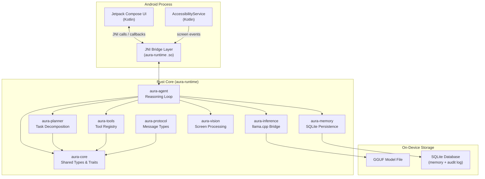
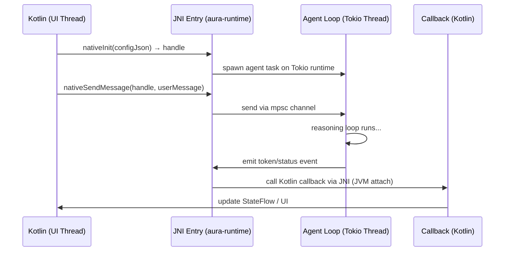
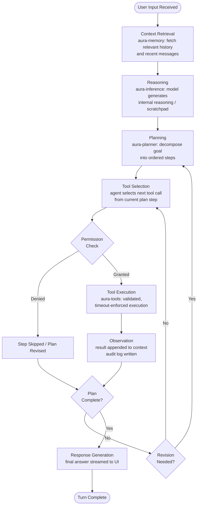
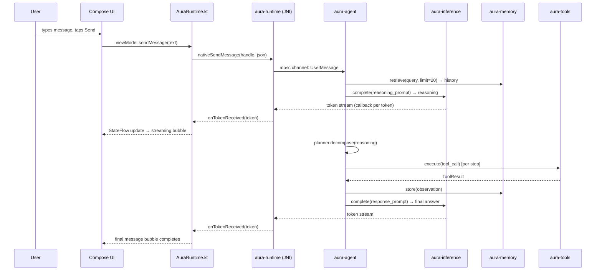
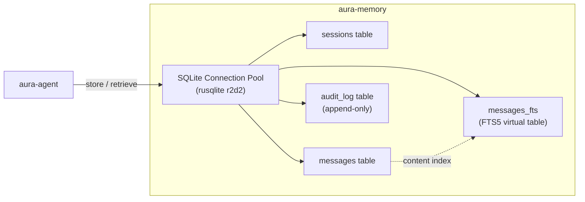
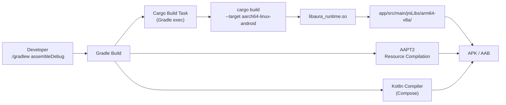

# AURA — Architecture Reference

> **A**utonomous **U**nified **R**easoning **A**gent  
> Version: 0.1 (Design) | Status: Phase 0 — Environment Validation

---

## Table of Contents

1. [Project Overview & Philosophy](#1-project-overview--philosophy)
2. [High-Level System Architecture](#2-high-level-system-architecture)
3. [Crate Workspace Structure](#3-crate-workspace-structure)
4. [Crate Responsibilities (Detailed)](#4-crate-responsibilities-detailed)
5. [JNI Integration Layer](#5-jni-integration-layer)
6. [Agent Execution Loop](#6-agent-execution-loop)
7. [Data Flow Diagrams](#7-data-flow-diagrams)
8. [Cross-Compilation Strategy](#8-cross-compilation-strategy)
9. [Build System](#9-build-system)
10. [Key Design Decisions & Trade-offs](#10-key-design-decisions--trade-offs)

---

## 1. Project Overview & Philosophy

### What is AURA?

AURA is a **local-first, fully autonomous AI agent** that runs entirely on-device on an Android phone. It combines a Rust systems core with a Jetpack Compose UI to deliver a private, low-latency, network-independent reasoning engine capable of planning, executing multi-step tool chains, and interacting with the Android OS itself.

There is no cloud backend. No model API. No telemetry. Every inference, every memory read, every tool execution happens on the device.

### Design Philosophy

AURA is built around five principles:

| Principle | Meaning |
|-----------|---------|
| **Local-first** | All computation, model inference, and data storage remain on-device. Network is opt-in, per-session, never silent. |
| **Rust-first** | The agent core, memory engine, inference bridge, and tool runtime are written in Rust. Kotlin is a presentation layer only. |
| **Unix-inspired modularity** | Each crate does one thing and exposes a minimal, versioned interface. Crates communicate through well-typed message protocols, not shared mutable state. |
| **Transparency** | Every action the agent takes is logged and surfaced to the user. The agent never acts silently on consequential operations. |
| **Minimal footprint** | The agent is designed to run comfortably within the constraints of a mid-range Android device (4–12 GB RAM, ARM64). |

### Target Platform

| Property | Value |
|----------|-------|
| Device | Reeder S71 (primary target) |
| OS | Android 14 (API 34+) |
| Architecture | ARM64 (aarch64) |
| RAM | 12 GB |
| Rust toolchain | 1.95.0 (NixOS system Rust, no rustup) |
| NDK | 27.2.12479018 |
| Android SDK | API 36 |
| Java | OpenJDK 17 |

---

## 2. High-Level System Architecture



---

## 3. Crate Workspace Structure

```
aura/                              # Git repository root
├── Cargo.toml                     # Workspace root — lists all member crates
├── Cargo.lock                     # Locked dependency graph
│
├── crates/
│   ├── aura-core/                 # Shared types, error types, traits, interfaces
│   │   ├── Cargo.toml
│   │   └── src/
│   │       ├── lib.rs
│   │       ├── error.rs
│   │       ├── types.rs           # AgentMessage, ToolCall, ToolResult, etc.
│   │       └── traits.rs          # Tool trait, MemoryBackend trait, etc.
│   │
│   ├── aura-agent/                # Reasoning loop, context, agent state machine
│   │   ├── Cargo.toml
│   │   └── src/
│   │       ├── lib.rs
│   │       ├── state_machine.rs   # AgentState enum + transitions
│   │       ├── context.rs         # Context window management
│   │       ├── loop_executor.rs   # Main agent loop
│   │       └── observation.rs     # Tool result → context integration
│   │
│   ├── aura-inference/            # llama.cpp JNI bridge, GGUF loading, streaming
│   │   ├── Cargo.toml
│   │   ├── build.rs               # Links llama.cpp static library
│   │   └── src/
│   │       ├── lib.rs
│   │       ├── engine.rs          # InferenceEngine struct
│   │       ├── stream.rs          # Token streaming via channels
│   │       ├── sampler.rs         # Sampling parameters (temp, top-p, etc.)
│   │       └── ffi.rs             # Unsafe bindings to llama.cpp C API
│   │
│   ├── aura-planner/              # Task decomposition, step planning
│   │   ├── Cargo.toml
│   │   └── src/
│   │       ├── lib.rs
│   │       ├── decomposer.rs      # Breaks goals into sub-tasks
│   │       ├── plan.rs            # Plan, Step, StepStatus types
│   │       └── revision.rs        # Re-planning on observation failure
│   │
│   ├── aura-memory/               # SQLite persistence, conversation history, search
│   │   ├── Cargo.toml
│   │   └── src/
│   │       ├── lib.rs
│   │       ├── db.rs              # SQLite pool (via rusqlite)
│   │       ├── schema.rs          # Database schema migrations
│   │       ├── conversation.rs    # Message storage and retrieval
│   │       ├── search.rs          # Full-text search (FTS5)
│   │       └── audit.rs           # Append-only audit log table
│   │
│   ├── aura-tools/                # Tool registry, Tool trait, built-in tools
│   │   ├── Cargo.toml
│   │   └── src/
│   │       ├── lib.rs
│   │       ├── registry.rs        # ToolRegistry: register, lookup, execute
│   │       ├── permission.rs      # Permission manifest, approval flow
│   │       ├── executor.rs        # Timeout-enforced tool execution wrapper
│   │       └── builtins/
│   │           ├── mod.rs
│   │           ├── read_file.rs
│   │           ├── write_file.rs
│   │           ├── shell.rs       # Restricted shell command tool
│   │           ├── http.rs        # Optional HTTP tool (user opt-in)
│   │           ├── app_launch.rs  # Launch Android apps
│   │           ├── notify.rs      # Read/dismiss notifications
│   │           ├── clipboard.rs
│   │           └── search_memory.rs
│   │
│   ├── aura-vision/               # Screen content processing
│   │   ├── Cargo.toml
│   │   └── src/
│   │       ├── lib.rs
│   │       ├── capture.rs         # Receives screen bitmaps from Kotlin
│   │       ├── ocr.rs             # Text extraction from screen regions
│   │       └── element_tree.rs    # Accessibility tree → structured representation
│   │
│   ├── aura-protocol/             # Structured message types between modules
│   │   ├── Cargo.toml
│   │   └── src/
│   │       ├── lib.rs
│   │       ├── messages.rs        # All inter-module message enums
│   │       └── codec.rs           # Serialization (serde + bincode or JSON)
│   │
│   └── aura-runtime/              # Lifecycle management, background work, JNI entry
│       ├── Cargo.toml
│       └── src/
│           ├── lib.rs
│           ├── jni_entry.rs       # #[no_mangle] extern "C" JNI functions
│           ├── callbacks.rs       # Rust → Kotlin callback dispatch
│           ├── lifecycle.rs       # Agent start/stop/pause/resume
│           ├── emergency_stop.rs  # Global AtomicBool kill switch
│           └── thread_pool.rs     # Tokio runtime for async agent work
│
├── android/                       # Android project root
│   ├── app/
│   │   ├── build.gradle.kts
│   │   └── src/
│   │       └── main/
│   │           ├── AndroidManifest.xml
│   │           ├── kotlin/dev/aura/
│   │           │   ├── MainActivity.kt
│   │           │   ├── AuraRuntime.kt     # JNI wrapper class
│   │           │   ├── ui/                # Compose screens
│   │           │   └── service/           # AccessibilityService
│   │           └── jniLibs/               # .so files land here after cargo build
│   ├── build.gradle.kts
│   └── settings.gradle.kts
│
└── docs/
    ├── ARCHITECTURE.md  ← this file
    ├── UI_DESIGN.md
    ├── SECURITY.md
    └── ROADMAP.md
```

### Workspace `Cargo.toml`

```toml
[workspace]
resolver = "2"
members = [
    "crates/aura-core",
    "crates/aura-agent",
    "crates/aura-inference",
    "crates/aura-planner",
    "crates/aura-memory",
    "crates/aura-tools",
    "crates/aura-vision",
    "crates/aura-protocol",
    "crates/aura-runtime",
]

[workspace.dependencies]
tokio         = { version = "1", features = ["full"] }
serde         = { version = "1", features = ["derive"] }
serde_json    = "1"
thiserror     = "1"
anyhow        = "1"
tracing       = "0.1"
jni           = "0.21"
rusqlite      = { version = "0.31", features = ["bundled", "vtab", "blob"] }
once_cell     = "1"
crossbeam     = "0.8"
```

---

## 4. Crate Responsibilities (Detailed)

### `aura-core`

The foundational crate. Every other crate depends on it; it depends on nothing within the workspace.

**Key types:**
```rust
pub enum AuraError { Inference(..), Memory(..), Tool(..), Permission(..), Cancelled }
pub type Result<T> = std::result::Result<T, AuraError>;

pub struct AgentMessage { pub role: Role, pub content: Content, pub timestamp: i64 }
pub enum Role { User, Agent, Tool, System }
pub enum Content { Text(String), ToolCall(ToolCall), ToolResult(ToolResult), Image(Vec<u8>) }

pub struct ToolCall { pub id: Uuid, pub name: String, pub arguments: serde_json::Value }
pub struct ToolResult { pub call_id: Uuid, pub output: serde_json::Value, pub error: Option<String> }
```

**Key traits:**
```rust
pub trait Tool: Send + Sync {
    fn name(&self) -> &str;
    fn description(&self) -> &str;
    fn parameters_schema(&self) -> serde_json::Value;
    fn permission_manifest(&self) -> PermissionManifest;
    async fn execute(&self, args: serde_json::Value) -> Result<serde_json::Value>;
}

pub trait MemoryBackend: Send + Sync {
    async fn store(&self, msg: &AgentMessage) -> Result<i64>;
    async fn retrieve(&self, query: &str, limit: usize) -> Result<Vec<AgentMessage>>;
    async fn get_history(&self, session_id: Uuid, limit: usize) -> Result<Vec<AgentMessage>>;
}
```

---

### `aura-agent`

Owns the agent reasoning loop and state machine. This is the "brain" crate — it orchestrates all other crates but contains no business logic for any individual capability.

**State machine:**
```
Idle → Receiving → ContextRetrieval → Reasoning → Planning
     → ToolSelection → PermissionCheck → ToolExecution
     → Observation → PlanRevision → Responding → Idle
```

Each state transition is logged. The `EmergencyStop` signal can interrupt any state and transition to `Idle`.

---

### `aura-inference`

Wraps llama.cpp via `unsafe` FFI bindings. Exposes a safe, async Rust API.

Key responsibilities:
- Load and validate GGUF model files
- Manage the `llama_context` lifecycle
- Stream tokens via a `tokio::sync::mpsc` channel
- Apply system prompt template formatting (ChatML, LLaMA-3, Gemma-style)
- Enforce a configurable max token budget per inference call

---

### `aura-planner`

Receives a high-level goal and a set of available tools, and produces a typed `Plan`:

```rust
pub struct Plan {
    pub goal: String,
    pub steps: Vec<Step>,
    pub created_at: i64,
}

pub struct Step {
    pub id: Uuid,
    pub description: String,
    pub tool: Option<String>,
    pub arguments: Option<serde_json::Value>,
    pub depends_on: Vec<Uuid>,
    pub status: StepStatus,
}

pub enum StepStatus { Pending, Running, Done(serde_json::Value), Failed(String), Skipped }
```

Plans are stored in memory and can be revised when a step fails or produces unexpected output.

---

### `aura-memory`

All SQLite operations live here. Uses `rusqlite` with the bundled feature (SQLite compiled into the binary).

**Schema (simplified):**

```sql
CREATE TABLE sessions (
    id TEXT PRIMARY KEY,
    created_at INTEGER NOT NULL,
    title TEXT
);

CREATE TABLE messages (
    id INTEGER PRIMARY KEY AUTOINCREMENT,
    session_id TEXT NOT NULL REFERENCES sessions(id),
    role TEXT NOT NULL,
    content TEXT NOT NULL,    -- JSON encoded
    timestamp INTEGER NOT NULL
);

CREATE VIRTUAL TABLE messages_fts USING fts5(content, content=messages, content_rowid=id);

CREATE TABLE audit_log (
    id INTEGER PRIMARY KEY AUTOINCREMENT,
    timestamp INTEGER NOT NULL,
    event_type TEXT NOT NULL,
    actor TEXT NOT NULL,
    payload TEXT NOT NULL,     -- JSON
    hash TEXT NOT NULL         -- SHA-256 of previous row hash + current payload
);
```

---

### `aura-tools`

Provides the `ToolRegistry` and the execution infrastructure.

```rust
pub struct ToolRegistry {
    tools: HashMap<String, Arc<dyn Tool>>,
    permission_store: Arc<PermissionStore>,
}

impl ToolRegistry {
    pub fn register(&mut self, tool: impl Tool + 'static);
    pub async fn execute(&self, call: ToolCall, ctx: &ExecutionContext) -> Result<ToolResult>;
    pub async fn request_permission(&self, manifest: &PermissionManifest) -> Result<bool>;
}
```

The `executor.rs` wraps each tool call in a `tokio::time::timeout`, capturing panics and converting them into typed errors.

---

### `aura-vision`

Receives raw bitmap data from the Android `MediaProjection` API (passed through JNI) or accessibility tree snapshots. Extracts structured text and UI element hierarchies for the agent to reason about.

---

### `aura-protocol`

Defines the typed message bus between async tasks within the agent process. Uses `tokio::sync::broadcast` and `tokio::sync::mpsc` channels. Keeps inter-module coupling to message types only.

---

### `aura-runtime`

The JNI entry point and lifecycle manager. The compiled output is `libaura_runtime.so`.

```rust
#[no_mangle]
pub extern "C" fn Java_dev_aura_AuraRuntime_nativeInit(
    env: JNIEnv, _class: JClass, config_json: JString
) -> jlong { /* returns handle pointer */ }

#[no_mangle]
pub extern "C" fn Java_dev_aura_AuraRuntime_nativeSendMessage(
    env: JNIEnv, _class: JClass, handle: jlong, message_json: JString
) { /* dispatches to agent loop */ }

#[no_mangle]
pub extern "C" fn Java_dev_aura_AuraRuntime_nativeDestroy(
    env: JNIEnv, _class: JClass, handle: jlong
) { /* drops agent, flushes memory */ }

#[no_mangle]
pub extern "C" fn Java_dev_aura_AuraRuntime_nativeEmergencyStop(
    env: JNIEnv, _class: JClass, handle: jlong
) { /* sets AtomicBool, interrupts inference */ }
```

---

## 5. JNI Integration Layer

### Design

The JNI layer follows a **handle-based** pattern: `nativeInit` returns a `jlong` which is a pointer to a heap-allocated `AgentHandle` struct (boxed via `Box::into_raw`). All subsequent JNI calls receive this handle and cast it back. Destruction calls `Box::from_raw` to reclaim memory.



### Threading Model

- The Kotlin main thread calls `nativeInit` and `nativeSendMessage` only — these are non-blocking.
- All agent work runs on a dedicated Tokio multi-threaded runtime within the `.so`.
- Callbacks from Rust to Kotlin use `JNIEnv::attach_current_thread()` to safely access the JVM from Tokio worker threads.
- The Kotlin side registers a callback object on init. Rust holds a `GlobalRef` to it.

### Callback Interface

```kotlin
// Kotlin side
interface AuraCallback {
    fun onTokenReceived(token: String)
    fun onStatusChanged(status: AgentStatus)
    fun onToolCallStarted(toolName: String, args: String)
    fun onToolCallCompleted(toolName: String, result: String)
    fun onPermissionRequired(manifest: String): Boolean
    fun onError(error: String)
}
```

Rust calls these via reflection using the `jni` crate's method lookup and invocation APIs.

---

## 6. Agent Execution Loop

The core loop is a state machine that processes one user turn at a time. It is cancellable at every `await` point via a `CancellationToken`.



### Loop Pseudocode

```rust
async fn agent_loop(ctx: AgentContext, cancel: CancellationToken) -> Result<()> {
    loop {
        let input = ctx.inbox.recv().await?;
        
        // 1. Context retrieval
        let history = ctx.memory.retrieve(&input.content, 20).await?;
        
        // 2. Reasoning (may stream tokens to UI)
        let reasoning = ctx.inference.complete(build_reasoning_prompt(&history, &input)).await?;
        
        // 3. Planning
        let plan = ctx.planner.decompose(&reasoning, &ctx.tool_registry).await?;
        ctx.ui_tx.send(Event::PlanCreated(plan.clone()))?;
        
        // 4. Execute steps
        for step in plan.steps.iter_mut() {
            cancel.check()?; // cancellation point
            
            if let Some(tool_name) = &step.tool {
                // 5. Permission check
                let manifest = ctx.tool_registry.permission_manifest(tool_name)?;
                if !ctx.permissions.check_or_request(manifest).await? {
                    step.status = StepStatus::Skipped;
                    continue;
                }
                
                // 6. Tool execution
                let result = ctx.tool_registry.execute(step.to_call(), &ctx).await;
                
                // 7. Observation
                step.status = match result {
                    Ok(v)  => StepStatus::Done(v),
                    Err(e) => StepStatus::Failed(e.to_string()),
                };
                ctx.memory.store(&step.to_message()).await?;
                ctx.audit.append(AuditEvent::tool_executed(&step)).await?;
            }
        }
        
        // 8. Plan revision if needed
        if plan.needs_revision() {
            ctx.planner.revise(&mut plan, &ctx.tool_registry).await?;
        }
        
        // 9. Response generation
        let response = ctx.inference.complete(build_response_prompt(&plan)).await?;
        ctx.memory.store(&response.to_message()).await?;
        ctx.ui_tx.send(Event::ResponseComplete(response))?;
    }
}
```

---

## 7. Data Flow Diagrams

### Message Flow: User Input to Response



### Memory Architecture



---

## 8. Cross-Compilation Strategy

### Target Triple

```
aarch64-linux-android
```

### NDK Toolchain

The NDK 27.2.12479018 provides a Clang-based cross-compiler located at:

```
~/Android/Sdk/ndk/27.2.12479018/toolchains/llvm/prebuilt/linux-x86_64/bin/
  aarch64-linux-android34-clang       ← C compiler
  aarch64-linux-android34-clang++     ← C++ compiler
  llvm-ar                             ← archiver
  llvm-strip                          ← stripper
```

### Cargo Configuration

`.cargo/config.toml` in the workspace root:

```toml
[target.aarch64-linux-android]
linker = "/home/teto/Android/Sdk/ndk/27.2.12479018/toolchains/llvm/prebuilt/linux-x86_64/bin/aarch64-linux-android34-clang"
ar     = "/home/teto/Android/Sdk/ndk/27.2.12479018/toolchains/llvm/prebuilt/linux-x86_64/bin/llvm-ar"

[env]
ANDROID_NDK_HOME = "/home/teto/Android/Sdk/ndk/27.2.12479018"
```

### Build Command (direct)

```bash
cargo build \
  --target aarch64-linux-android \
  --release \
  -p aura-runtime
```

Output: `target/aarch64-linux-android/release/libaura_runtime.so`

### NixOS Note

Because the system Rust is provided by NixOS (not rustup), adding the `aarch64-linux-android` target requires a NixOS configuration change:

```nix
# In configuration.nix or flake.nix
environment.systemPackages = with pkgs; [
  (rust-bin.stable."1.95.0".default.override {
    targets = [ "aarch64-linux-android" ];
  })
];
```

Until that is resolved, an alternative is to use `cargo-ndk` installed as a cargo tool or to manually invoke the NDK clang with the appropriate `--target` flag.

### `cargo-ndk` Approach (Alternative)

```bash
cargo install cargo-ndk
cargo ndk \
  --target aarch64-linux-android \
  --android-platform 34 \
  build --release -p aura-runtime
```

`cargo-ndk` automatically sets up the linker and sysroot from the `ANDROID_NDK_HOME` environment variable.

---

## 9. Build System

### Overview

Gradle is the top-level orchestrator. The Android build invokes a Gradle task that shells out to `cargo` for native compilation, then copies the resulting `.so` into the correct `jniLibs` directory.



### Gradle Cargo Task

```kotlin
// app/build.gradle.kts
val cargoDir = rootProject.file("../")  // workspace root

tasks.register<Exec>("cargoBuildRelease") {
    workingDir(cargoDir)
    commandLine(
        "cargo", "build",
        "--target", "aarch64-linux-android",
        "--release",
        "-p", "aura-runtime"
    )
    environment("ANDROID_NDK_HOME", System.getProperty("user.home") + "/Android/Sdk/ndk/27.2.12479018")
}

tasks.register<Copy>("copyNativeLibs") {
    dependsOn("cargoBuildRelease")
    from("${cargoDir}/target/aarch64-linux-android/release/libaura_runtime.so")
    into("src/main/jniLibs/arm64-v8a/")
}

tasks.named("preBuild") {
    dependsOn("copyNativeLibs")
}
```

### Kotlin JNI Loader

```kotlin
// AuraRuntime.kt
object AuraRuntime {
    init {
        System.loadLibrary("aura_runtime")
    }

    private external fun nativeInit(configJson: String): Long
    private external fun nativeSendMessage(handle: Long, messageJson: String)
    private external fun nativeEmergencyStop(handle: Long)
    private external fun nativeDestroy(handle: Long)

    // ... public API wrapping the above
}
```

---

## 10. Key Design Decisions & Trade-offs

### Decision 1: Rust core over Kotlin coroutines for agent logic

**Why:** Rust provides memory safety without a GC, which is critical for a long-running agent process that manages large context buffers and GGUF model state. Kotlin coroutines are excellent for UI work but less appropriate for tight inference loops where allocation latency matters.

**Trade-off:** JNI crossing has overhead (marshalling, string copies). Mitigated by batching UI updates and keeping JNI calls coarse-grained (full JSON messages, not per-token calls for internal state).

---

### Decision 2: SQLite over a custom file format for memory

**Why:** SQLite's FTS5 extension provides full-text search out of the box. It is well-tested, ACID-compliant, and has excellent Rust bindings (`rusqlite`). The single-file database model fits the local-first philosophy.

**Trade-off:** For very large conversation histories (millions of messages), vector similarity search would be more appropriate. Future: integrate `sqlite-vec` for embedding-based retrieval.

---

### Decision 3: Monorepo (workspace) for all Rust crates

**Why:** Shared `Cargo.lock` ensures consistent dependency versions across all crates. Refactoring across crate boundaries is straightforward. The workspace dependency table avoids version drift.

**Trade-off:** Build times for the full workspace are higher. Mitigated by incremental compilation and `sccache`.

---

### Decision 4: No cloud fallback

**Why:** Preserves privacy, eliminates API cost, works without internet. The agent must be genuinely useful offline.

**Trade-off:** Capability is bounded by what can run on-device. Mitigated by using quantized GGUF models (Q4_K_M and above) that achieve competitive quality within a 4–8 GB RAM budget.

---

### Decision 5: Handle-based JNI over global singleton

**Why:** A handle-based design supports multiple agent instances (useful for testing) and avoids global mutable state in the Rust layer.

**Trade-off:** Slight complexity in the Kotlin wrapper. Kotlin must not drop the handle prematurely; enforced by tying the handle lifetime to the Application lifecycle.

---

*Last updated: Phase 0 — Environment Validation*  
*Next: See [ROADMAP.md](./ROADMAP.md) for Phase 1 deliverables.*
