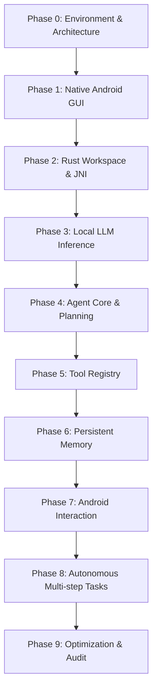

# AURA — Master Roadmap & Acceptance Criteria

> Project: AURA (Autonomous Unified Reasoning Agent)  
> Version: 0.1 | Last Updated: 2026-10-31  
> Execution Standard: Zero-compromise, verified phases

---

## Roadmap Overview

---

## Phase 0: Architecture & Environment Validation
- **Status**: Completed / In Final Verification
- **Goal**: Validate Android SDK, NDK, Rust cross-compilation toolchain, write architectural foundations, and create workspace scaffolding.
- **Deliverables**:
  - `ARCHITECTURE.md`, `UI_DESIGN.md`, `SECURITY.md`, `ROADMAP.md` in `docs/`
  - Cargo workspace with 9 crates (`aura-core`, `aura-protocol`, `aura-agent`, `aura-planner`, `aura-inference`, `aura-tools`, `aura-vision`, `aura-memory`, `aura-runtime`)
  - Target `aarch64-linux-android` toolchain configured with NDK r27c linker.
- **Acceptance Criteria**:
  - `cargo check --workspace` passes without errors.
  - Test binary cross-compiles to ARM64 Android ELF.

---

## Phase 1: Native Android GUI & Navigation
- **Goal**: Implement a complete, dark-first Jetpack Compose interface matching the visual identity.
- **Deliverables**:
  - 5 primary destinations: Home, Chat, Activity, Memory, Settings.
  - Component hierarchy: `AgentStatusBadge`, `ChatBubble`, `ToolCallCard`, `PlanningStepCard`, `ResourceCard`.
  - App icons and themes loaded and styled.
- **Acceptance Criteria**:
  - Gradle builds a valid, installable debug APK (`assembleDebug`).
  - All 5 screens render cleanly with zero visual stutter.

---

## Phase 2: Rust Workspace & Android Native Integration
- **Goal**: Establish the C-ABI FFI bridge (`jni` crate) connecting Android Kotlin with Rust core.
- **Deliverables**:
  - `libaura_runtime.so` compiled for `arm64-v8a`.
  - `AuraEngine.kt` singleton exposing native lifecycle: `nativeInit()`, `nativeProcessMessage()`, `nativeEmergencyStop()`, `nativeDestroy()`.
  - JNI ping-pong test verifying bidirectionality.
- **Acceptance Criteria**:
  - APK packages `libaura_runtime.so` in `lib/arm64-v8a/`.
  - App launches and displays Rust runtime initialization status.

---

## Phase 3: Local LLM Inference
- **Goal**: Embed llama.cpp native inference engine running quantized GGUF models directly on-device.
- **Deliverables**:
  - `aura-inference` backend implementing `llama.cpp` C++ binding.
  - GGUF model loader supporting Q4_K_M quantization.
  - Token streaming channel into Kotlin Compose UI via JNI callbacks.
- **Acceptance Criteria**:
  - Successfully load a 1B–3B GGUF model on ARM64.
  - Token generation speed observable with real-time UI streaming.

---

## Phase 4: Agent Core & Planning
- **Goal**: Implement deterministic agent reasoning loop with structured state machine.
- **Deliverables**:
  - State machine: `Idle`, `Thinking`, `Planning`, `ExecutingTool`, `WaitingForApproval`, `Paused`.
  - Planner decomposing multi-step user prompts into discrete step graphs.
  - Context window manager with sliding conversation history.
- **Acceptance Criteria**:
  - Agent parses multi-step prompt and plans at least 3 discrete steps.
  - Emergency stop halts reasoning in under 50ms.

---

## Phase 5: Tool Registry & Execution Sandboxing
- **Goal**: Secure, schema-driven tool execution system.
- **Deliverables**:
  - `Tool` trait with async execution and JSON schema definitions.
  - Initial tools: `DateTimeTool`, `DeviceInfoTool`, `FileSearchTool`, `AppLauncherTool`.
  - Permission validator and execution timeout guard.
- **Acceptance Criteria**:
  - Tools execute within isolated Tokio tasks.
  - Out-of-schema parameters fail safely with actionable errors.

---

## Phase 6: Persistent Memory & SQLite
- **Goal**: Structured on-device memory store with full search and inspection capabilities.
- **Deliverables**:
  - SQLite schema: `memories`, `conversations`, `messages`, `audit_log`.
  - Full-text search over past user memories.
  - Memory screen UI wired to inspect, edit, and wipe storage.
- **Acceptance Criteria**:
  - Conversation persists across app restarts.
  - Audit log records all agent tool operations append-only.

---

## Phase 7: Android System Interaction
- **Goal**: Empower agent with accessibility and system automation capabilities without root.
- **Deliverables**:
  - `AuraAccessibilityService` for UI tree inspection and click/scroll dispatch.
  - `MediaProjection` integration for visual screen capture with user consent.
  - Android Intent manager for launching target applications.
- **Acceptance Criteria**:
  - Agent can locate an on-screen button by text and click it via accessibility.
  - Permission state observable and revokable from Settings.

---

## Phase 8: Autonomous Multi-Step Tasks
- **Goal**: End-to-end autonomous task execution chaining planning, tools, and UI observation.
- **Deliverables**:
  - Observation-Action-Reflection cycle.
  - Dynamic plan re-routing when a tool call fails.
  - Task progress and timeline inspection on Activity Screen.
- **Acceptance Criteria**:
  - Agent completes a real-world multi-step task (e.g., "Find note X and open app Y") autonomously.
  - User can pause, review, and cancel mid-task.

---

## Phase 9: Optimization, Testing & Security Audit
- **Goal**: Harden performance, battery efficiency, and security posture.
- **Deliverables**:
  - Memory profiling under low-RAM conditions (target device: Reeder S71, 12GB RAM).
  - Comprehensive unit and integration test suite across Rust and Android.
  - Security audit verifying zero data leakage and airtight sandboxing.
- **Acceptance Criteria**:
  - Zero memory leaks during prolonged agent operation.
  - 100% test pass rate across all crate unit tests.
