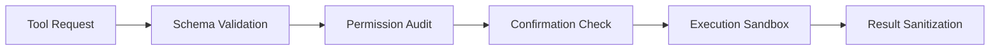

# AURA — Security Design Specification

> Version: 0.1 | Status: Phase 0 Reference Architecture

---

## Table of Contents

1. [Threat Model & Security Objectives](#1-threat-model--security-objectives)
2. [Principle of Least Privilege](#2-principle-of-least-privilege)
3. [Network Policy & Isolation](#3-network-policy--isolation)
4. [Tool Execution Sandboxing & Validation](#4-tool-execution-sandboxing--validation)
5. [User Approval Flows & Human-in-the-Loop](#5-user-approval-flows--human-in-the-loop)
6. [Emergency Stop Mechanism](#6-emergency-stop-mechanism)
7. [Android Permission Justification & Boundary](#7-android-permission-justification--boundary)
8. [Sensitive Data Handling & Memory Security](#8-sensitive-data-handling--memory-security)
9. [Tamper-Evident Audit Logging](#9-tamper-evident-audit-logging)
10. [Security Lifecycle & Vulnerability Response](#10-security-lifecycle--vulnerability-response)

---

## 1. Threat Model & Security Objectives

AURA is a local-first autonomous agent operating directly on consumer Android devices. Unlike cloud-based assistants, AURA executes actions in the user's primary computing environment where private messages, financial applications, and personal credentials reside.

### Primary Threat Vectors:
- **Indirect Prompt Injection**: Malicious instructions embedded in screen content, notifications, or local documents attempting to hijack the agent loop.
- **Unintended Automation Loops**: Infinite execution cycles that could drain battery, overwrite user files, or perform unauthorized app actions.
- **Data Exfiltration**: Unauthorized network transmissions leaking conversation history, device metadata, or screen captures.
- **Privilege Escalation via Tools**: Tools misinterpreting input schemas to perform out-of-bounds file system operations or intent broadcasts.

### Core Security Objectives:
- **Offline By Default**: Complete air-gap guarantee unless explicitly unlocked by the user.
- **Deterministic Action Boundaries**: Tools can only execute within strict JSON schema contracts.
- **Zero Silent Telemetry**: All data remains on-device within private application sandbox storage.
- **User Dominance**: The user retains instantaneous kill-switch authority at every reasoning iteration.

---

## 2. Principle of Least Privilege

Every component in AURA operates with the minimal set of capabilities required to fulfill its duty:

- **Rust Core Workspace**: Has no direct Android OS capability. It only interacts with the outside world via explicitly mediated tool traits.
- **Per-Tool Permissions**: Every tool defines a static list of required permissions in its `ToolSchema`:
  ```rust
  pub struct ToolSchema {
      pub id: String,
      pub name: String,
      pub description: String,
      pub parameters: serde_json::Value,
      pub required_permissions: Vec<String>,
  }
  ```
- **Dynamic Permission Check**: The agent execution loop verifies tool enablement and permission grants prior to dispatching arguments.

---

## 3. Network Policy & Isolation

1. **Default State: Disabled**:
   - The default `AuraConfig::network_enabled` is set to `false`.
   - Android network security configuration enforces strict localhost or disabled cleartext traffic.
2. **User Opt-In**:
   - Network tools require explicit runtime confirmation on first use.
   - Any external network request generates an audit record with domain, payload size, and timestamp.
3. **Model Inference**:
   - Inference is purely local via `llama.cpp` CPU/GPU offload. No inference prompts or tokens are ever sent over HTTP/gRPC.

---

## 4. Tool Execution Sandboxing & Validation

Before executing any tool, AURA performs a four-stage validation pipeline:



1. **Schema Validation**: Inputs are validated against standard JSON Schema definitions using `serde_json`. Malformed or unexpected parameters trigger immediate tool rejection.
2. **Path Sanitization**: Local file tools restrict access strictly to user-designated directories; path traversal (`../`) is rejected unconditionally.
3. **Execution Timeout**: Every tool execution is bounded by a configurable timeout (default 10s) using Tokio cancellation tokens.
4. **Result Sanitization**: Output returned from tools is inspected to prevent prompt injection payload injection into subsequent reasoning context.

---

## 5. User Approval Flows & Human-in-the-Loop

Consequential actions require explicit visual confirmation before execution.

### Consequential Action Classification:
- Modifying, deleting, or overwriting local files.
- Sending SMS or making phone calls via Android Intents.
- Modifying system settings or entering sensitive credentials.
- Automating UI interactions inside third-party payment or banking apps.

### Confirmation Protocol:
- The agent loop halts state to `AgentStatus::WaitingForUser`.
- The Android GUI presents a distinct Approval Modal highlighting:
  - Exact action description.
  - Target application or file.
  - Parameter payload.
- Execution only resumes upon cryptographic/biometric or explicit UI confirmation.

---

## 6. Emergency Stop Mechanism

Safety demands an instantaneous, non-blocking kill-switch:

- **Atomic Stop Flag**: Every `AgentContext` holds an `Arc<AtomicBool>` emergency stop flag.
- **Zero-Latency Polling**: At every step (context retrieval, token generation, tool pre-check, tool post-check), `should_stop()` is evaluated.
- **UI Exposure**: A persistent, prominent stop control in the Android UI immediately toggles the atomic flag.
- **Safe Rollback**: In-flight tools receive a cooperative cancellation signal, and partial state is marked as cancelled in the task history.

---

## 7. Android Permission Justification & Boundary

AURA avoids invasive device root access, relying exclusively on public Android SDK/NDK capabilities:

| Permission / Service | Purpose | Security Mitigation |
|---|---|---|
| `AccessibilityService` | Inspect UI nodes & execute user-directed taps/scrolls | Only active during explicit autonomous tasks; disabled when idle |
| `MediaProjection` | Screen observation for vision reasoning | Requires explicit system cast consent dialog per session |
| `POST_NOTIFICATIONS` | Foreground task progress alerts | Standard notification channel |
| `FOREGROUND_SERVICE` | Prevent OS process termination during active reasoning | Requires persistent notification showing agent status |

Root access and arbitrary shell execution (`su` / `/system/bin/sh`) are strictly excluded from the codebase.

---

## 8. Sensitive Data Handling & Memory Security

- **Storage Location**: All persistent SQLite databases (`aura_memory.db`) reside inside Android's internal app sandbox (`/data/user/0/app.aura/files/`).
- **No Shared External Storage**: Data is never saved to shared external storage (`/sdcard`) without explicit file-picker export by the user.
- **In-Memory Hygiene**: Sensitive tokens and private data are zeroized on drop where feasible.
- **Screen Filter**: The screen observer automatically flags and masks detected password fields (`inputType="textPassword"`) before ingestion by the model.

---

## 9. Tamper-Evident Audit Logging

Every agent decision and tool execution is recorded in an append-only SQLite `audit_log` table:

```sql
CREATE TABLE IF NOT EXISTS audit_log (
    id          INTEGER PRIMARY KEY AUTOINCREMENT,
    timestamp   TEXT NOT NULL,
    event_type  TEXT NOT NULL,
    description TEXT NOT NULL
);
```

- **Logged Events**: Tool invocations, permission grant/revocation, model load/unload, user approval decisions, and emergency stops.
- **Inspectability**: The user can review the full audit log via the Settings and Activity screens.
- **Exportability**: Logs can be exported as structured JSON for offline verification.

---

## 10. Security Lifecycle & Vulnerability Response

1. **Dependency Auditing**: Automatic `cargo audit` in CI to detect vulnerabilities in third-party Rust crates.
2. **Minimal Dependencies**: Strict dependency curation in both Cargo and Gradle.
3. **Local Testing**: Fuzzing of tool schemas and parser endpoints to ensure edge cases fail safely.
