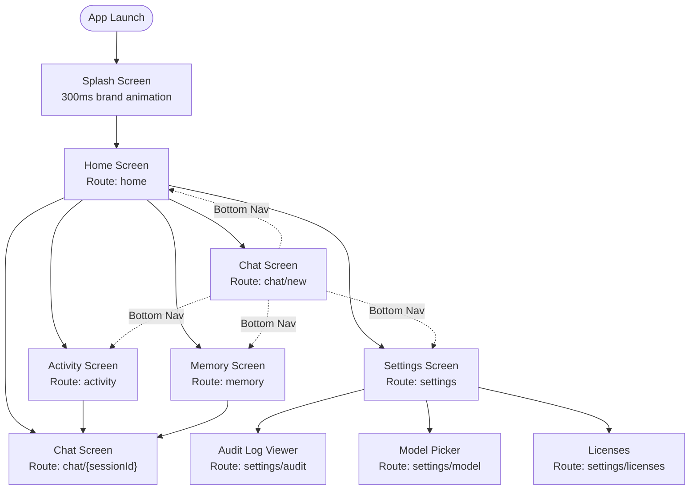

# AURA — UI/UX Design Specification

> Version: 0.1 | Status: Phase 0 (Design Complete, Implementation Pending Phase 1)

---

## Table of Contents

1. [Visual Identity & Design Philosophy](#1-visual-identity--design-philosophy)
2. [Color Palette](#2-color-palette)
3. [Typography System](#3-typography-system)
4. [Spacing & Layout Grid](#4-spacing--layout-grid)
5. [Component Library](#5-component-library)
6. [Screen Specifications](#6-screen-specifications)
7. [Navigation Structure](#7-navigation-structure)
8. [Animation Specifications](#8-animation-specifications)
9. [Accessibility Requirements](#9-accessibility-requirements)
10. [Adaptive Layout](#10-adaptive-layout)

---

## 1. Visual Identity & Design Philosophy

### Identity

AURA is a private, local AI agent. Its visual language must communicate **intelligence, trust, and restraint**. The UI should feel like a precision instrument — not a consumer chatbot. Dark, dense, and information-rich, but never cluttered.

### Principles

| Principle | Application |
|-----------|------------|
| **Dark-first** | Dark background at all times. No light mode in v1. System dark mode is assumed. |
| **Restrained glow** | Cyan and violet accents glow subtly on interactive elements. Glow is earned, not decorative. |
| **Information density** | Status, context, and agent state are always visible. The user should never wonder "what is the agent doing?" |
| **Motion with purpose** | Animations communicate state change or progression. No decorative motion. |
| **Material 3 foundation** | Built on Compose Material 3 tokens, overridden with the AURA palette. This ensures accessibility baseline compliance. |

### Mood Reference

> Deep space + precision instrument + terminal aesthetics. Think: a dark cockpit display with crisp cyan readouts. Not science fiction — scientific.

---

## 2. Color Palette

### Base Surfaces

| Role | Name | Hex | Usage |
|------|------|-----|-------|
| Background | `auraBackground` | `#0D0D0F` | App background, bottom of every screen |
| Surface | `auraSurface` | `#111114` | Cards, bottom sheets, dialogs |
| Surface Variant | `auraSurfaceVariant` | `#1A1A1F` | Input fields, secondary cards, list items |
| Surface Elevated | `auraSurfaceElevated` | `#202028` | Popovers, tooltips, floating cards |
| Outline | `auraOutline` | `#2A2A35` | Dividers, card borders, input borders |
| Outline Variant | `auraOutlineVariant` | `#1F1F28` | Subtle separators |

### Accent Colors

| Role | Name | Hex | Usage |
|------|------|-----|-------|
| Primary (Cyan) | `auraPrimary` | `#00D4FF` | CTAs, active nav, agent speaking indicator, links |
| Primary Dim | `auraPrimaryDim` | `#0099BB` | Pressed state for primary elements |
| Primary Container | `auraPrimaryContainer` | `#003344` | Backgrounds behind primary content |
| On Primary | `auraOnPrimary` | `#000000` | Text/icons on cyan backgrounds |
| Secondary (Violet) | `auraSecondary` | `#7C3AED` | Tool calls, planning steps, secondary actions |
| Secondary Dim | `auraSecondaryDim` | `#5B21B6` | Pressed state for secondary elements |
| Secondary Container | `auraSecondaryContainer` | `#1E1040` | Backgrounds behind secondary content |
| On Secondary | `auraOnSecondary` | `#FFFFFF` | Text/icons on violet backgrounds |
| Tertiary (Amber) | `auraTertiary` | `#F59E0B` | Warnings, pending states |
| Tertiary Container | `auraTertiaryContainer` | `#2D1F00` | Warning card backgrounds |

### Semantic Colors

| Role | Name | Hex | Usage |
|------|------|-----|-------|
| Error | `auraError` | `#FF4D6D` | Error states, failed tools, destructive actions |
| Error Container | `auraErrorContainer` | `#3D0015` | Error card backgrounds |
| On Error | `auraOnError` | `#FFFFFF` | Text on error backgrounds |
| Success | `auraSuccess` | `#22D3A0` | Completed steps, successful tool calls |
| Success Container | `auraSuccessContainer` | `#003025` | Success card backgrounds |
| On Surface | `auraOnSurface` | `#E8E8F0` | Primary text on surfaces |
| On Surface Variant | `auraOnSurfaceVariant` | `#9090A8` | Secondary text, labels, captions |
| On Background | `auraOnBackground` | `#E8E8F0` | Primary text on background |

### Glow / Shadow Colors

| Role | Hex | Opacity | Usage |
|------|-----|---------|-------|
| Cyan glow shadow | `#00D4FF` | 30% | Box shadow on active elements, streaming indicator |
| Violet glow shadow | `#7C3AED` | 25% | Tool call cards |
| Surface shadow | `#000000` | 40% | Elevation shadows on dark surfaces |

### Compose Color Scheme Definition

```kotlin
val AuraDarkColorScheme = darkColorScheme(
    background        = Color(0xFF0D0D0F),
    surface           = Color(0xFF111114),
    surfaceVariant    = Color(0xFF1A1A1F),
    surfaceContainer  = Color(0xFF202028),
    outline           = Color(0xFF2A2A35),
    outlineVariant    = Color(0xFF1F1F28),
    primary           = Color(0xFF00D4FF),
    primaryContainer  = Color(0xFF003344),
    onPrimary         = Color(0xFF000000),
    secondary         = Color(0xFF7C3AED),
    secondaryContainer= Color(0xFF1E1040),
    onSecondary       = Color(0xFFFFFFFF),
    error             = Color(0xFFFF4D6D),
    errorContainer    = Color(0xFF3D0015),
    onError           = Color(0xFFFFFFFF),
    onSurface         = Color(0xFFE8E8F0),
    onSurfaceVariant  = Color(0xFF9090A8),
    onBackground      = Color(0xFFE8E8F0),
)
```

---

## 3. Typography System

AURA uses **Inter** as the primary typeface (latin characters, UI text) and **JetBrains Mono** for all code, tool arguments, and raw output. Both are bundled as app assets.

### Type Scale

| Level | Font | Size | Weight | Line Height | Letter Spacing | Usage |
|-------|------|------|--------|-------------|----------------|-------|
| `DisplayLarge` | Inter | 32sp | SemiBold (600) | 40sp | -0.5sp | Screen titles, large headings |
| `DisplayMedium` | Inter | 24sp | SemiBold (600) | 32sp | -0.25sp | Section headers |
| `HeadlineLarge` | Inter | 20sp | SemiBold (600) | 28sp | 0 | Card titles, dialog headings |
| `HeadlineMedium` | Inter | 18sp | Medium (500) | 26sp | 0 | Sub-section headers |
| `TitleLarge` | Inter | 16sp | SemiBold (600) | 24sp | 0 | List item titles, button labels |
| `TitleMedium` | Inter | 14sp | Medium (500) | 22sp | 0.1sp | Secondary titles |
| `BodyLarge` | Inter | 16sp | Regular (400) | 24sp | 0 | Main body text, chat messages |
| `BodyMedium` | Inter | 14sp | Regular (400) | 22sp | 0.25sp | Supporting body text |
| `BodySmall` | Inter | 12sp | Regular (400) | 18sp | 0.25sp | Captions, metadata |
| `LabelLarge` | Inter | 14sp | Medium (500) | 20sp | 0.1sp | Badges, chips, nav labels |
| `LabelMedium` | Inter | 12sp | Medium (500) | 16sp | 0.5sp | Status text |
| `LabelSmall` | Inter | 10sp | Medium (500) | 14sp | 0.5sp | Timestamps, micro-labels |
| `CodeLarge` | JetBrains Mono | 14sp | Regular (400) | 22sp | 0 | Code blocks, tool output |
| `CodeMedium` | JetBrains Mono | 12sp | Regular (400) | 20sp | 0 | Inline code, short values |
| `CodeSmall` | JetBrains Mono | 11sp | Regular (400) | 18sp | 0 | Compact log entries |

### Compose Typography Definition

```kotlin
val AuraTypography = Typography(
    displayLarge  = TextStyle(fontFamily = InterFamily, fontWeight = SemiBold, fontSize = 32.sp),
    headlineLarge = TextStyle(fontFamily = InterFamily, fontWeight = SemiBold, fontSize = 20.sp),
    titleLarge    = TextStyle(fontFamily = InterFamily, fontWeight = SemiBold, fontSize = 16.sp),
    bodyLarge     = TextStyle(fontFamily = InterFamily, fontWeight = Normal,   fontSize = 16.sp),
    bodyMedium    = TextStyle(fontFamily = InterFamily, fontWeight = Normal,   fontSize = 14.sp),
    bodySmall     = TextStyle(fontFamily = InterFamily, fontWeight = Normal,   fontSize = 12.sp),
    labelLarge    = TextStyle(fontFamily = InterFamily, fontWeight = Medium,   fontSize = 14.sp),
    labelSmall    = TextStyle(fontFamily = InterFamily, fontWeight = Medium,   fontSize = 10.sp),
)

val CodeMono = FontFamily(Font(R.font.jetbrains_mono_regular))
```

---

## 4. Spacing & Layout Grid

### Baseline Grid

All layout measurements use an **8dp baseline grid**. Exceptions use the 4dp half-grid for tight internal padding.

| Token | Value | Usage |
|-------|-------|-------|
| `spacing.xs` | 4dp | Inline padding, icon-to-label gaps |
| `spacing.sm` | 8dp | Small internal padding |
| `spacing.md` | 16dp | Standard card padding, list item padding |
| `spacing.lg` | 24dp | Section gaps, screen padding |
| `spacing.xl` | 32dp | Large section separators |
| `spacing.xxl` | 48dp | Hero section spacing |

### Corner Radii

| Token | Value | Usage |
|-------|-------|-------|
| `radius.xs` | 4dp | Chips, small badges |
| `radius.sm` | 8dp | Input fields, small cards |
| `radius.md` | 12dp | Standard cards |
| `radius.lg` | 16dp | Bottom sheets, large cards |
| `radius.xl` | 24dp | Full-width banners |
| `radius.full` | 9999dp | Pills, circular buttons |

### Screen Padding

- Horizontal screen padding: **16dp** (compact), **24dp** (medium+)
- Bottom content padding: **80dp** (accounts for bottom nav bar height)

---

## 5. Component Library

### 5.1 ChatBubble

Displays a single message in the chat thread.

**Variants:**
- `User`: Right-aligned, `auraPrimaryContainer` background, `auraPrimary` accent border on left
- `Agent`: Left-aligned, `auraSurface` background, subtle left border
- `System`: Center-aligned, `auraOutline` border, italic text, no background fill
- `Streaming`: Agent variant with animated streaming cursor appended

**Anatomy:**
```
┌─────────────────────────────────────┐
│ [Avatar/Icon]  [Role Label]  [Time] │
│                                     │
│  Message text content here,         │
│  possibly multiline.                │
│                                     │
│  [Reaction bar — optional]          │
└─────────────────────────────────────┘
```

**Spec:**
- Max width: 85% of screen width
- Padding: 12dp horizontal, 10dp vertical
- Corner radius: `radius.md` (12dp), flat on the "origin" corner
- Avatar: 28dp circle, agent = cyan ring, user = neutral ring
- Timestamp: `LabelSmall`, `auraOnSurfaceVariant`, right-aligned below bubble
- Long-press: copy, regenerate, pin actions

```kotlin
@Composable
fun ChatBubble(
    message: AgentMessage,
    isStreaming: Boolean = false,
    onLongPress: () -> Unit = {},
)
```

---

### 5.2 ToolCallCard

Displays an in-progress or completed tool invocation inline in the chat thread.

**States:** `Pending`, `Running` (animated), `Completed`, `Failed`

**Anatomy:**
```
┌──────────────────────────────────────┐
│ 🔧  read_file          [Running...]  │
│ ─────────────────────────────────── │
│ args: {"path": "/data/notes.txt"}   │
│                                      │
│ ▼ Result (tap to expand)             │
│   "File contents: Hello world..."    │
└──────────────────────────────────────┘
```

**Spec:**
- Background: `auraSurfaceVariant`
- Left accent bar: 3dp wide, `auraSecondary` color
- Running state: left bar pulses with `auraSecondary` glow
- Failed state: left bar becomes `auraError`, red tint on header
- Args: rendered in `CodeMedium` font
- Result: collapsible, 4-line preview, expand on tap
- Full border radius: `radius.md`

```kotlin
@Composable
fun ToolCallCard(
    toolCall: ToolCall,
    result: ToolResult?,
    state: ToolCallState,
    expanded: Boolean = false,
    onExpandToggle: () -> Unit = {},
)
```

---

### 5.3 PlanningStepCard

Shows one step in the agent's current execution plan.

**States:** `Pending`, `Running`, `Done`, `Failed`, `Skipped`

**Anatomy:**
```
┌────────────────────────────────────────┐
│  ● Step 2 of 5                  [Done] │
│  Read the contents of the target file  │
│  Tool: read_file                        │
└────────────────────────────────────────┘
```

**Spec:**
- Step indicator: numbered circle, filled with `auraPrimary` when done, outlined when pending
- Status badge: right-aligned, color-coded (cyan=done, violet=running, amber=pending, red=failed)
- Completed steps have a subtle strikethrough on the description
- Running step has a shimmer animation on the background

---

### 5.4 AgentStatusBadge

A compact pill showing the agent's current operational state.

**States:**

| State | Color | Icon | Label |
|-------|-------|------|-------|
| `Idle` | `auraOnSurfaceVariant` | ⬤ static | Idle |
| `Thinking` | `auraPrimary` | ⬤ pulse | Thinking |
| `Executing` | `auraSecondary` | ⬤ pulse | Executing |
| `Streaming` | `auraPrimary` | ▶ animate | Responding |
| `Error` | `auraError` | ✕ | Error |
| `Stopped` | `auraError` | ◼ | Stopped |

**Spec:**
- Height: 24dp
- Corner radius: `radius.full`
- Padding: 6dp horizontal, 4dp vertical
- Font: `LabelMedium`
- Dot icon: 6dp circle, animated with `infiniteTransition` alpha oscillation when active

```kotlin
@Composable
fun AgentStatusBadge(status: AgentStatus)
```

---

### 5.5 MemoryCard

Displays a single memory entry in the Memory screen.

**Anatomy:**
```
┌───────────────────────────────────────┐
│ [Session icon]  "Planning notes task" │
│ 12 messages · 2h ago                  │
│                                       │
│ Preview: "I need you to help me org…" │
└───────────────────────────────────────┘
```

**Spec:**
- Background: `auraSurface`
- Hover/press state: `auraSurfaceVariant` with 200ms fade
- Session icon: 40dp rounded square, color based on session hash
- Preview text: 2 lines max, ellipsized
- Swipe-to-delete: red background reveals on right swipe

---

### 5.6 ModelInfoCard

Displays the currently loaded model's metadata.

**Anatomy:**
```
┌────────────────────────────────────────┐
│ ◉ Qwen 2.5 7B Q4_K_M           Active │
│ ──────────────────────────────────── │
│ Context: 8192 tokens  │  Size: 4.7 GB │
│ RAM used: 5.1 GB      │  Speed: 18 t/s │
└────────────────────────────────────────┘
```

**Spec:**
- Active indicator: `auraPrimary` dot + subtle glow
- Stat grid: 2×2, `BodySmall` labels, `TitleMedium` values
- Progress bar showing RAM headroom: `auraPrimary` fill, `auraOutline` track

---

### 5.7 TaskCard

Displayed in the Activity screen for multi-step tasks.

**States:** `Planning`, `Running`, `Completed`, `Failed`, `Paused`

**Anatomy:**
```
┌───────────────────────────────────────────┐
│  "Organize my notes folder"    [Running]  │
│  ████████████░░░░░░░░  4 / 7 steps        │
│  Currently: Listing directory contents    │
│  Started: 2 min ago                       │
└───────────────────────────────────────────┘
```

**Spec:**
- Progress bar: `auraPrimary` fill (steps done / total)
- Status badge: same spec as `AgentStatusBadge`
- Tap: expands to show all planning steps inline

---

### 5.8 QuickActionButton

Circular FAB-style button for common actions on the Home screen.

**Spec:**
- Size: 64dp (large), 48dp (small)
- Background: `auraSurfaceElevated`
- Icon: 24dp (large), 18dp (small), `auraPrimary`
- Border: 1dp `auraOutline`
- Press: scale to 0.95, 100ms spring
- Label below: `LabelSmall`, `auraOnSurfaceVariant`

**Predefined quick actions:**
1. New Chat
2. New Task
3. Memory Search
4. Model Settings
5. Emergency Stop (red tint)

---

### 5.9 BottomNavBar

Material 3 `NavigationBar` with 5 destinations.

**Spec:**
- Height: 80dp (includes system gesture inset)
- Background: `auraSurface` with `auraBackground` shadow at top
- Active indicator: `auraPrimaryContainer` pill behind active icon
- Active icon/label color: `auraPrimary`
- Inactive color: `auraOnSurfaceVariant`
- Label: always visible (`LabelSmall`)
- Icons: outlined when inactive, filled when active

**Destinations:**

| Index | Label | Icon (outline / filled) |
|-------|-------|------------------------|
| 0 | Home | `home_outlined` / `home` |
| 1 | Chat | `chat_bubble_outline` / `chat_bubble` |
| 2 | Activity | `pending_actions` / `pending_actions` |
| 3 | Memory | `database` / `database` |
| 4 | Settings | `settings_outlined` / `settings` |

---

## 6. Screen Specifications

### 6.1 Home Screen

**Route:** `home`  
**Purpose:** Dashboard — overview of agent state, quick actions, recent activity.

**Layout:**

```
┌─────────────────────────────────────────┐
│  ≡  AURA                    [●Idle]     │  ← TopAppBar
├─────────────────────────────────────────┤
│                                         │
│  ┌─────────────────────────────────┐   │
│  │  ModelInfoCard                   │   │
│  │  Qwen 2.5 7B · Active · 18 t/s  │   │
│  └─────────────────────────────────┘   │
│                                         │
│  Quick Actions                          │
│  ┌──────┐ ┌──────┐ ┌──────┐ ┌──────┐  │
│  │ Chat │ │ Task │ │ Mem  │ │ Stop │  │
│  └──────┘ └──────┘ └──────┘ └──────┘  │
│                                         │
│  Recent Sessions                        │
│  ┌─────────────────────────────────┐   │
│  │ MemoryCard (session 1)           │   │
│  │ MemoryCard (session 2)           │   │
│  │ MemoryCard (session 3)           │   │
│  └─────────────────────────────────┘   │
│                                         │
└─────────────────────────────────────────┘
│  [Home] [Chat] [Activity] [Mem] [Set]  │  ← BottomNavBar
```

**Behavior:**
- ModelInfoCard refreshes every 5 seconds (RAM, speed stats)
- Recent Sessions list shows last 5 sessions, sorted by last activity
- Tapping a session card navigates to Chat with that session loaded
- Emergency Stop button shows a confirmation bottom sheet before triggering

---

### 6.2 Chat Screen

**Route:** `chat/{sessionId}`  
**Purpose:** Conversational interface with the agent.

**Layout:**

```
┌─────────────────────────────────────────┐
│  ←  Chat                    [● Idle]    │  ← TopAppBar with back, session menu
├─────────────────────────────────────────┤
│                                         │
│  ┌───────────────────────────────────┐  │
│  │  [System] New session started     │  │
│  │                                   │  │
│  │           [User bubble]           │  │
│  │  [Agent bubble (streaming...)]    │  │
│  │    ┌─────────────────────────┐    │  │
│  │    │ ToolCallCard: read_file │    │  │
│  │    └─────────────────────────┘    │  │
│  │  [Agent bubble (final)]           │  │
│  └───────────────────────────────────┘  │
│                                         │
├─────────────────────────────────────────┤
│  ┌─────────────────────────────────┐   │
│  │ [Input field]        [Attach] ↑ │   │  ← Input bar
│  └─────────────────────────────────┘   │
└─────────────────────────────────────────┘
```

**Components:**
- `LazyColumn` with reversed scroll for messages (newest at bottom)
- Auto-scroll to bottom on new message, unless user has scrolled up
- Input field: `OutlinedTextField`, placeholder "Message AURA…", multiline up to 5 lines
- Send button: animated — morphs from `send` icon to `stop` icon when agent is responding
- Attach button: opens bottom sheet for file/image attachment (Phase 7+)
- Agent status badge in TopAppBar updates in real-time
- Tool call cards appear inline as the agent executes tools
- Planning section: collapsible `PlanningStepCard` list appears above tool calls

---

### 6.3 Activity Screen

**Route:** `activity`  
**Purpose:** Monitor all current and past multi-step autonomous tasks.

**Layout:**

```
┌─────────────────────────────────────────┐
│  Activity                   [Filter ▼] │  ← TopAppBar
├─────────────────────────────────────────┤
│  Active Tasks (1)                       │
│  ┌─────────────────────────────────┐   │
│  │ TaskCard (Running)               │   │
│  └─────────────────────────────────┘   │
│                                         │
│  Completed (12)                         │
│  ┌─────────────────────────────────┐   │
│  │ TaskCard (Completed)             │   │
│  │ TaskCard (Failed)                │   │
│  │ ...                              │   │
│  └─────────────────────────────────┘   │
└─────────────────────────────────────────┘
```

**Behavior:**
- Active tasks auto-refresh via `StateFlow` from the agent runtime
- Tapping a running task navigates to Chat with that task's session
- Tapping a completed task opens a read-only task detail bottom sheet
- Filter: by status (All / Active / Completed / Failed) and date range

---

### 6.4 Memory Screen

**Route:** `memory`  
**Purpose:** Browse, search, and manage all conversation history.

**Layout:**

```
┌─────────────────────────────────────────┐
│  Memory                     [+ New]    │  ← TopAppBar
├─────────────────────────────────────────┤
│  ┌─────────────────────────────────┐   │
│  │ 🔍 Search conversations...       │   │  ← SearchBar (sticky)
│  └─────────────────────────────────┘   │
│                                         │
│  ┌─────────────────────────────────┐   │
│  │ MemoryCard (session 1)           │   │
│  │ MemoryCard (session 2)           │   │
│  │ MemoryCard (session 3)           │   │
│  │ MemoryCard (session 4)           │   │
│  │ ...                              │   │
│  └─────────────────────────────────┘   │
└─────────────────────────────────────────┘
```

**Behavior:**
- Search triggers FTS5 query on `messages` table via `aura-memory` (debounced 300ms)
- Search results highlight matched terms in preview text
- Swipe-to-delete shows confirmation snackbar with undo
- Long-press a card: share transcript, export JSON, delete
- Empty state: illustration + "No conversations yet. Start a new chat."

---

### 6.5 Settings Screen

**Route:** `settings`  
**Purpose:** Configure the agent, model, permissions, and network.

**Layout (grouped list):**

```
┌─────────────────────────────────────────┐
│  Settings                              │
├─────────────────────────────────────────┤
│  MODEL                                  │
│  ┌─────────────────────────────────┐   │
│  │ Active Model         Qwen 2.5 7B│   │
│  │ Context Length         8192 toks│   │
│  │ Temperature               0.7   │   │
│  │ Max Tokens               2048   │   │
│  └─────────────────────────────────┘   │
│                                         │
│  NETWORK                                │
│  ┌─────────────────────────────────┐   │
│  │ Allow Network Access    [OFF]   │   │
│  │ HTTP Tool               [OFF]   │   │
│  └─────────────────────────────────┘   │
│                                         │
│  PERMISSIONS                            │
│  ┌─────────────────────────────────┐   │
│  │ Accessibility Service  [Grant]  │   │
│  │ Screen Capture         [Grant]  │   │
│  │ Storage Access         [Grant]  │   │
│  └─────────────────────────────────┘   │
│                                         │
│  SECURITY                               │
│  ┌─────────────────────────────────┐   │
│  │ Audit Log             [View]    │   │
│  │ Clear All Memory      [Clear]   │   │
│  │ Emergency Stop Config [Config]  │   │
│  └─────────────────────────────────┘   │
│                                         │
│  ABOUT                                  │
│  ┌─────────────────────────────────┐   │
│  │ Version                 0.1.0   │   │
│  │ Rust Core            1.95.0   │   │
│  │ Open Source Licenses  [View]    │   │
│  └─────────────────────────────────┘   │
└─────────────────────────────────────────┘
```

**Behavior:**
- Model selection: bottom sheet with list of GGUF files in model directory
- Network toggle: requires confirmation dialog ("This allows the agent to make HTTP requests")
- Permission rows: show system permission status; tap to open system settings or grant dialog
- Clear Memory: double-confirmation (dialog + type "DELETE")
- Audit Log: navigates to a read-only log viewer screen

---

## 7. Navigation Structure



### NavHost Definition

```kotlin
@Composable
fun AuraNavHost(navController: NavHostController) {
    NavHost(navController, startDestination = "home") {
        composable("home") { HomeScreen(navController) }
        composable("chat/new") { ChatScreen(navController, sessionId = null) }
        composable(
            "chat/{sessionId}",
            arguments = listOf(navArgument("sessionId") { type = NavType.StringType })
        ) { backStackEntry ->
            ChatScreen(navController, sessionId = backStackEntry.arguments?.getString("sessionId"))
        }
        composable("activity") { ActivityScreen(navController) }
        composable("memory") { MemoryScreen(navController) }
        composable("settings") { SettingsScreen(navController) }
        composable("settings/audit") { AuditLogScreen(navController) }
        composable("settings/model") { ModelPickerScreen(navController) }
        composable("settings/licenses") { LicensesScreen(navController) }
    }
}
```

### Transition Animations

- **Push (forward):** Slide in from right, fade out departing screen (duration: 300ms, `FastOutSlowIn`)
- **Pop (back):** Slide out to right, fade in incoming screen (duration: 250ms, `FastOutLinearIn`)
- **Bottom nav switch:** Cross-fade only (duration: 200ms)

---

## 8. Animation Specifications

### 8.1 Message Appear Animation

When a new chat bubble enters the list:

```kotlin
AnimatedVisibility(
    visible = visible,
    enter = slideInVertically(
        initialOffsetY = { it / 2 },
        animationSpec = spring(dampingRatio = 0.8f, stiffness = 300f)
    ) + fadeIn(animationSpec = tween(200))
)
```

- Duration: ~250ms (spring natural)
- Easing: spring with `dampingRatio = 0.8` (slight bounce)
- Direction: slides up from half-height below final position

### 8.2 Streaming Cursor

A blinking `|` cursor appended to agent text while streaming:

```kotlin
val alpha by infiniteTransition.animateFloat(
    initialValue = 1f, targetValue = 0f,
    animationSpec = infiniteRepeatable(
        animation = tween(500, easing = LinearEasing),
        repeatMode = RepeatMode.Reverse
    )
)
Text(text = "${streamingText}|", modifier = Modifier.alpha(alpha * cursorAlpha))
```

- Blink period: 500ms on, 500ms off
- Cursor character: `█` (block) or `|` (pipe), 70% opacity max

### 8.3 Agent Status Transitions

The `AgentStatusBadge` dot animates when transitioning between states:

```kotlin
val pulseAlpha by infiniteTransition.animateFloat(
    initialValue = 0.4f, targetValue = 1.0f,
    animationSpec = infiniteRepeatable(tween(800), RepeatMode.Reverse)
)
// Applied only when status is Thinking, Executing, or Streaming
```

State label cross-fades over 200ms when the status changes.

### 8.4 Tool Call Card Running Animation

The left accent bar pulses its shadow/glow:

```kotlin
val glowRadius by infiniteTransition.animateFloat(
    initialValue = 2f, targetValue = 8f,
    animationSpec = infiniteRepeatable(tween(900, easing = FastOutSlowInEasing), RepeatMode.Reverse)
)
```

### 8.5 Progress Bar Shimmer (Planning Steps)

Running `PlanningStepCard` has a shimmer gradient moving across it:

- Gradient: transparent → `auraSurfaceElevated` 30% → transparent
- Duration: 1.2 seconds, looping
- Direction: left to right

### 8.6 Emergency Stop Button

Press-and-hold 1.5 seconds to activate:

```kotlin
// Arc progress indicator fills over 1.5 seconds of hold
// Releases: spring back animation (200ms)
// Activated: scale pulse (1.0 → 1.15 → 1.0, 300ms), color flash to auraError
```

---

## 9. Accessibility Requirements

### WCAG 2.1 AA Compliance

All text must meet **4.5:1 contrast ratio** against its background.

| Text Color | Background | Ratio |
|-----------|-----------|-------|
| `#E8E8F0` | `#0D0D0F` | ≈ 16.2:1 ✓ |
| `#E8E8F0` | `#111114` | ≈ 15.1:1 ✓ |
| `#9090A8` | `#0D0D0F` | ≈ 5.4:1 ✓ |
| `#00D4FF` | `#003344` | ≈ 4.9:1 ✓ |
| `#000000` | `#00D4FF` | ≈ 19.5:1 ✓ |

### Content Descriptions

Every icon-only button **must** have a `contentDescription`:

```kotlin
Icon(
    imageVector = Icons.Default.Stop,
    contentDescription = "Emergency stop agent",
    tint = auraError
)
```

### Touch Targets

All interactive elements must have a minimum touch target of **48×48dp** per Android accessibility guidelines. Use `Modifier.minimumInteractiveComponentSize()`.

### Screen Reader (TalkBack)

- Chat bubbles: role described as "Message from [User/Agent], [timestamp]: [content]"
- Tool call cards: "Tool call [name], status [state]"
- Status badges: live region, announces state changes automatically

```kotlin
Modifier.semantics {
    liveRegion = LiveRegionMode.Polite
    contentDescription = "Agent status: ${status.label}"
}
```

### Focus Management

- When the agent starts responding, focus moves to the streaming bubble
- When a tool call completes, a snackbar is announced to TalkBack
- Settings screen: focusable order follows visual order

### Reduced Motion

Respect `LocalAccessibilityManager.current.isAnimationEnabled`:

```kotlin
val animationsEnabled = LocalAccessibilityManager.current?.isAnimationEnabled ?: true
val duration = if (animationsEnabled) 300 else 0
```

---

## 10. Adaptive Layout

### Breakpoints

| Class | Width | Layout |
|-------|-------|--------|
| Compact | < 600dp | Single column, bottom nav, default spec |
| Medium | 600–840dp | Two-column on tablets: nav rail + content |
| Expanded | > 840dp | Three-column: nav rail + conversation list + detail |

### Compact (Phone — Primary Target)

All spec above applies. Bottom navigation bar.

### Medium (Tablet / Foldable)

```
┌──────┬────────────────────────────────┐
│ Nav  │                                │
│ Rail │    Main Content Area           │
│      │                                │
│ [H]  │                                │
│ [C]  │                                │
│ [A]  │                                │
│ [M]  │                                │
│ [S]  │                                │
└──────┴────────────────────────────────┘
```

- Navigation rail replaces bottom bar
- Screen padding increases to `spacing.lg` (24dp)

### Expanded (Large Tablet / Desktop)

```
┌──────┬──────────────┬─────────────────┐
│ Nav  │ Session List │ Chat / Detail   │
│ Rail │              │                 │
│      │ [Memory 1]   │ Chat messages   │
│      │ [Memory 2]   │                 │
│      │ [Memory 3]   │                 │
└──────┴──────────────┴─────────────────┘
```

- Three-pane layout
- Permanent navigation drawer on left
- Middle pane: session/conversation list
- Right pane: detail view (chat, task detail, etc.)

### Implementation

Use `WindowSizeClass` from the Compose Material 3 adaptive library:

```kotlin
val windowSizeClass = calculateWindowSizeClass(this)
val navType = when (windowSizeClass.widthSizeClass) {
    WindowWidthSizeClass.Compact  -> NavigationType.BottomNavigation
    WindowWidthSizeClass.Medium   -> NavigationType.NavigationRail
    WindowWidthSizeClass.Expanded -> NavigationType.PermanentDrawer
    else                          -> NavigationType.BottomNavigation
}
```

---

*Last updated: Phase 0 — Design Complete*  
*Next: See [ROADMAP.md](./ROADMAP.md) Phase 1 for UI implementation milestones.*
